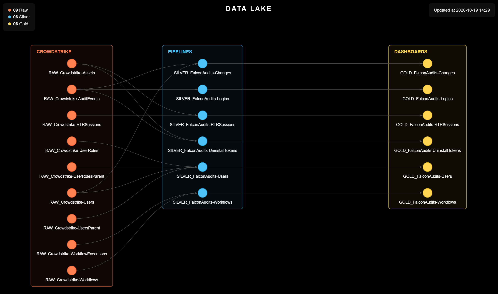

# Tenant Audit (CrowdStrike)

> Turns the users, workflows, Real Time Response sessions and audit log of a CrowdStrike Falcon tenant into monthly files ready for the Data Lake and the GOLD indicators.

<p align="center">
  
</p>

<table width="100%">
<thead>
<tr><th>Before<div></div></th><th>Now<div></div></th><th>What it buys<div></div></th></tr>
</thead>
<tbody>
<tr><td>No visibility into what happened inside the tenant: who accessed the console and from where, who revealed uninstall tokens, which commands ran over RTR on the servers, who created or changed API clients and granted roles, which users were inactive and which workflows were turned off.</td><td>Monthly files with the users and their roles, the workflows and their executions, every RTR session and command, every console access, every uninstall token revealed and every change to API clients, roles and uninstall protection.</td><td>Points that used to stay hidden now have numbers, month after month, ready to become indicators. Collection is automatic and takes the manual work of gathering this information off the analyst.</td></tr>
</tbody>
</table>

---

## Why This Project Exists

**Situation:** Much of what happened in the tenant went unwatched: uninstall tokens revealed, commands executed over RTR on servers, API clients created or with their secret rotated, roles granted, users who never logged in, workflows turned off. These points only came up when someone went looking for them, one at a time, in the console.

**Task:** Build a monthly collection, following the CYBER__ project standard, that gives visibility into access and sensitive actions in the tenant and feeds the Catalog documentation and the GOLD indicators.

**Action:** Four scripts read the CrowdStrike Falcon APIs (User Management, Workflows, Real Time Response Audit, Hosts and Event Streams) with the credential obtained from the vault. Two take a snapshot of the moment (users and workflows); the other two collect the events of the previous calendar month (RTR sessions and the audit log).

**Result:** Collection becomes automatic: every month, `Datas/MM-YYYY/` receives six CSVs that stack into history and show, in numbers, what could not be seen before.

---

<details>
<summary><strong>Scripts</strong> (click to expand)</summary>

<table width="100%">
<thead>
<tr><th>Script<div></div></th><th>What it does<div></div></th></tr>
</thead>
<tbody>
<tr><td><code>Scripts/1. Falcon/1.1. Generate_Users.py</code></td><td>Reads the tenant's users and writes <code>FalconAudits-Users.csv</code>, one row per user: name, e-mail, UUID, status, creation date, last login and the days since it, the roles, the number of roles, the grant type, whether the user is a Falcon Administrator, and <code>Item: Activity</code> (Ok with a login in the last 45 days; Attention with no login in that window or no login at all). The users of the global CID live in the tenant management project, with the same columns, so the two files stack.</td></tr>
<tr><td><code>Scripts/1. Falcon/1.2. Generate_Workflows.py</code></td><td>Reads the tenant's workflows and writes <code>FalconAudits-Workflows.csv</code>, one row per workflow: name, description, whether it is active, trigger type and event, version, last change, executions and failed executions in the previous calendar month (a failure is any execution that did not finish successfully), date of the last execution, <code>Item: Validation</code> (Attention when the workflow has a validation error) and <code>Item: Failures</code> (Attention when there was a failure in the previous month).</td></tr>
<tr><td><code>Scripts/1. Falcon/1.3. Generate_RTRSessions.py</code></td><td>Reads the Real Time Response sessions opened in the previous calendar month and writes <code>FalconAudits-RTRSessions.csv</code>, one row per command (a session with no command becomes one row with <code>-</code>): session date and time, id, user, origin (API or console), host, host type (server, domain controller, workstation), duration, command, full command line and command time. Reading is done day by day, because over the whole month at once the API stops returning part of the sessions; the script warns if, on any day, the count read does not match the API total.</td></tr>
<tr><td><code>Scripts/1. Falcon/1.4. Generate_AuditEvents.py</code></td><td>Reads the tenant's Event Stream a single time and writes three files with the events of the previous calendar month: <code>FalconAudits-Logins.csv</code> (every login, two-factor verification, SSO access and tenant switch, with user, result, IP, city and country), <code>FalconAudits-UninstallTokens.csv</code> (every uninstall token revealed, with who requested it, the host, its platform and type, and the justification) and <code>FalconAudits-Changes.csv</code> (every API client creation, change, deletion and secret rotation, every role granted or removed and every change to the uninstall protection of the sensor update policies, with who made it, the target, the before and after, the result, the IP and the country). Policy changes carry no result in the source and get <code>-</code> in the Result column.</td></tr>
</tbody>
</table>

</details>

<details>
<summary><strong>Setup and Usage</strong> (click to expand)</summary>

**Windows**

```
python -m venv .venv
.venv\Scripts\Activate.ps1
```

**Linux**

```
python3 -m venv .venv
source .venv/bin/activate
```

(Skip this step if `.venv` already exists.)

```
cd Scripts
pip install -r requirements.txt
```

The scripts are independent and can run in any order, once a month, **in the first days of the month**: the Event Stream keeps about 34 days, and `1.4` only closes the whole previous month if it runs before that month's first days leave the stream (when that happens, the script warns that the month came out partial). Every read of the stream is recorded in the tenant's own audit log, under the project's API client.

```
python './1. Falcon/1.1. Generate_Users.py'
python './1. Falcon/1.2. Generate_Workflows.py'
python './1. Falcon/1.3. Generate_RTRSessions.py'
python './1. Falcon/1.4. Generate_AuditEvents.py'
```

```
deactivate
```

</details>

---

## License

Released under the MIT License, like the rest of this repository. Full terms in [LICENCE.md](../../LICENCE.md).
