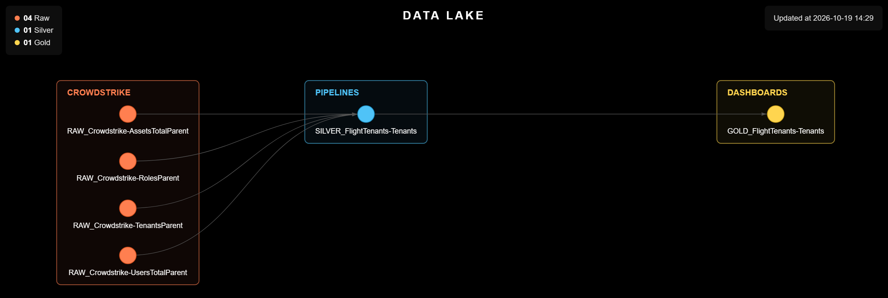

# Tenant Management (CrowdStrike)

> Turns the CrowdStrike Falcon Flight Control tenant hierarchy, with the hosts, users and modules of each CID, into a monthly file ready for the Data Lake and the GOLD indicators.

<p align="center">
  
</p>

<table width="100%">
<thead>
<tr><th>Before<div></div></th><th>Now<div></div></th><th>What it buys<div></div></th></tr>
</thead>
<tbody>
<tr><td>About 1 day of work per month: logging into each Flight Control tenant by hand, counting hosts and users and writing down the enabled modules.</td><td>A monthly file with every tenant in the hierarchy (global, parents and final CIDs), their domains, the host and user totals and the modules enabled in each one, and another with the users of the global CID.</td><td>A management view of every client in one place, groupable by parent, with the month-by-month history of host growth and module adoption.</td></tr>
</tbody>
</table>

---

## Why This Project Exists

**Situation:** Knowing how many tenants exist in Flight Control, how many hosts and users each one has and which modules are enabled took about 1 day of work per month. Each tenant had to be opened in the console, one at a time, and everything counted and written down by hand.

**Task:** Build a monthly collection, following the CYBER__ project standard, that walks the whole tenant hierarchy, brings back the totals and modules of each CID and feeds the Catalog documentation and the GOLD indicators.

**Action:** One script reads the CrowdStrike Falcon Flight Control hierarchy with the global CID credential obtained from the vault, logs into each tenant below it, counts the hosts and users and reads the available roles, from which it infers the enabled modules. A second script lists the users of the global CID itself, with their roles and last login.

**Result:** Collection becomes automatic: every month, `Datas/MM-YYYY/` receives two CSVs, the snapshot of every tenant and that of the global CID users, which stack into history.

---

<details>
<summary><strong>Scripts</strong> (click to expand)</summary>

<table width="100%">
<thead>
<tr><th>Script<div></div></th><th>What it does<div></div></th></tr>
</thead>
<tbody>
<tr><td><code>Scripts/1. Falcon/1.1. Generate_Tenants.py</code></td><td>Walks the Flight Control hierarchy from the global CID and writes <code>FlightTenants.csv</code>, one row per tenant under the level above it: the global, the parents and the final CIDs. A CID linked to two parents appears once under each, with <code>Shared Tenant</code> = True. For each tenant it brings the type, parent, name, CID, status, domains, the host and user totals and one True/False column per module: Cloud Security, Data Protection, Device Control, Discover, Firewall Management, Falcon for IT, Falcon for Mobile, Forensics, Identity Threat Protection, Insight XDR, Next-Gen SIEM, Prevent and Spotlight. For the parents, the totals are the ones the API returns, which include the hosts and users of the tenants below them; the global has no name or domains in the API. The API does not expose the subscriptions, so the modules are inferred from the roles available in each CID: Next-Gen SIEM also shows as enabled where only Falcon Log Management exists, Discover also shows where Falcon for IT exists, and Prevent, being the base of the platform, shows in all of them. At the end, the script lists the new roles not yet in the module table.</td></tr>
<tr><td><code>Scripts/1. Falcon/1.2. Generate_Users.py</code></td><td>Reads the users of the global CID, without logging into the tenants below it, and writes <code>FlightTenants-Users.csv</code>, one row per user: name, e-mail, UUID, status, creation date, last login and the days since it, the roles (including those granted by Flight Control for the tenants below), the number of roles, the grant type, whether the user is a Falcon Administrator, and <code>Item: Activity</code> (Ok with a login in the last 45 days; Attention with no login in that window or no login at all). The columns are the same as the users file of the tenant audit project, so the two stack.</td></tr>
</tbody>
</table>

</details>

<details>
<summary><strong>Setup and Usage</strong> (click to expand)</summary>

**Windows**

```
python -m venv .venv
.venv\Scripts\Activate.ps1
```

**Linux**

```
python3 -m venv .venv
source .venv/bin/activate
```

(Skip this step if `.venv` already exists.)

```
cd Scripts
pip install -r requirements.txt
```

The two scripts are independent and can run in any order; run them once a month: each run takes a snapshot of the hierarchy, of the totals and modules of each tenant, and of the global CID users, at that moment.

```
python './1. Falcon/1.1. Generate_Tenants.py'
python './1. Falcon/1.2. Generate_Users.py'
```

```
deactivate
```

</details>

---

## License

Released under the MIT License, like the rest of this repository. Full terms in [LICENCE.md](../../LICENCE.md).
