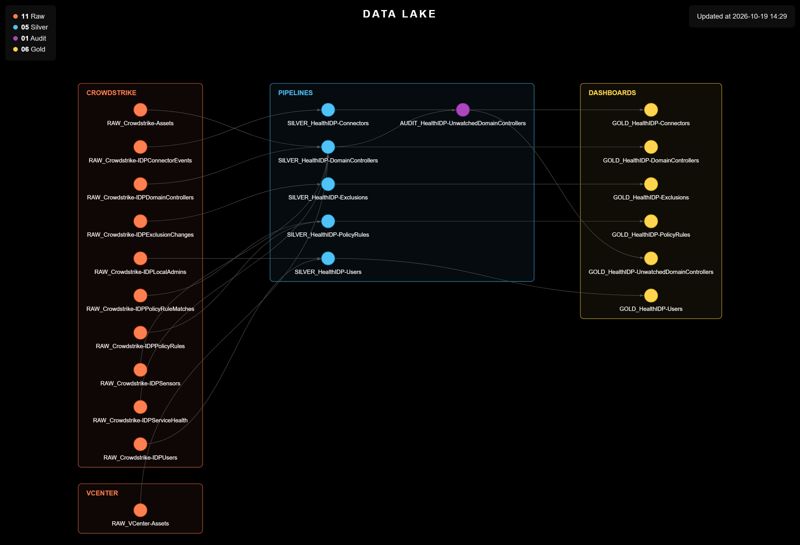

# Identity Protection Health Check

> Turns the scattered configuration of CrowdStrike Falcon Identity Protection into a monthly report: domain controller health, account risk, detection exclusions, connectors and conditional access rules, cross-referenced against the real server inventory.

<p align="center">
  
</p>

<table width="100%">
<thead>
<tr><th>Before<div></div></th><th>Now<div></div></th><th>What it buys<div></div></th></tr>
</thead>
<tbody>
<tr><td>~10 hours by hand every cycle, across the console, NGSIEM dashboards and timeline events</td><td>one pipeline that consolidates everything into five monthly reports, in the same standard as the other health checks</td><td>silent failures — a DC in limited functionality, a stopped connector, a changed exclusion — no longer go unnoticed</td></tr>
</tbody>
</table>

---

## Why This Project Exists

**Situation:** Identity Protection protects Active Directory, but the health view is fragmented: the sensor configuration on the DCs lives in the console, resource consumption and service alerts in an NGSIEM dashboard, account risk in GraphQL, and connectors and detection exclusions only show up as events in the timeline. Gathering all of that by hand took an analyst roughly **10 hours** every cycle, and, without consolidation, a DC in limited mode, a connector with an expired credential or a new exclusion can go days without being noticed.

**Task:** Bring those signals together in monthly reports, in the same format as the EDR Health Check, so that Identity Protection health is checked without browsing the console screen by screen.

**Action:** Every domain controller is pulled from Falcon with its per-protocol sensor configuration, enriched with its risk factors and the service health of the last 7 days, and cross-referenced against the VCenter inventory by MAC address to assign the department; whatever cannot be matched is set aside instead of dropped. Every user gets their risk factors, privileged roles, machines and local administrator rights. Detection exclusions and connectors, which the API does not list directly, are rebuilt from the timeline history, with the last person responsible for each change. Conditional access rules are listed with their conditions and how many times they were triggered, and those that exist but are not actually enforced are flagged.

**Result:** The Identity Protection health check becomes automatic and repeatable — replacing roughly **10 hours** of manual work every cycle — with the history accumulated month by month through the reference columns of each report.

---

<details>
<summary><strong>Scripts</strong> (click to expand)</summary>

<table width="100%">
<thead>
<tr><th>Script<div></div></th><th>What it does<div></div></th></tr>
</thead>
<tbody>
<tr><td><code>Scripts/1. VCenter/1.1. Extract_Assets.py</code></td><td>Pulls the VM inventory from VCenter (hostname, MAC address, department), skipping templates. This is the source of truth used to attribute every domain controller to the right department.</td></tr>
<tr><td><code>Scripts/2. IDP/2.1. Generate_Controllers.py</code></td><td>Pulls every domain controller known to Identity Protection: sensor status and its cause, the mode of each protocol (Kerberos, NTLM, LDAP, LDAPS, SMB, RDP), the applied policy and the DC's risk factors. Aggregates the service health via NGSIEM (cloud connectivity, Traffic Inspection, pending KB, CPU, memory, disk and health alerts). Cross-references each DC against the VCenter inventory by MAC address to assign a department; DCs it cannot match — including those AD still lists but that have no sensor — are set aside in an "Unwatched" file.</td></tr>
<tr><td><code>Scripts/2. IDP/2.2. Generate_Users.py</code></td><td>Pulls every Identity Protection user, joining the AD account and the Entra ID one: department, account type, privileged roles, account state, password and last activity. Lists each user's machines and where they are a local administrator, directly or through a group, and flags each risk factor (no MFA, old password, duplicated password, old account, hidden privileges) as its own column.</td></tr>
<tr><td><code>Scripts/2. IDP/2.3. Generate_Exclusions.py</code></td><td>Lists every detection whose exclusions have ever been configured or changed: title, type, MITRE tactic and technique, number of changes, date of the last one and who made it. The API does not expose the content of the exclusions, only the change history.</td></tr>
<tr><td><code>Scripts/2. IDP/2.4. Generate_Connectors.py</code></td><td>Rebuilds the current list of connectors (IDaaS and MFA) from the configuration history and validates whether each one is active; when there is an open failure, it brings the status and the error message.</td></tr>
<tr><td><code>Scripts/2. IDP/2.5. Generate_PolicyRules.py</code></td><td>Lists the Identity Protection policy rules (conditional access): whether they are active or in simulation, the action (block or MFA), each included or excluded condition (access type, protocol, user type, attributes and privileges, source endpoints and destinations, with the names resolved) and whether the rule generates an indicator or an e-mail. Counts how many times each rule was triggered, in total and in the last 30 days, and the date of the last trigger, rebuilt from the timeline history. Flags with <code>Item: Enforced</code> whether the rule is actually enforced: active and out of simulation mode.</td></tr>
</tbody>
</table>

</details>

<details>
<summary><strong>Setup and Usage</strong> (click to expand)</summary>

**Windows**

```
python -m venv .venv
.venv\Scripts\Activate.ps1
```

**Linux**

```
python3 -m venv .venv
source .venv/bin/activate
```

(Skip this step if `.venv` already exists.)

```
cd Scripts
pip install -r requirements.txt
```

Run the VCenter extraction first: the domain controllers script depends on it to attribute a department.

```
python './1. VCenter/1.1. Extract_Assets.py'
python './2. IDP/2.1. Generate_Controllers.py'
python './2. IDP/2.2. Generate_Users.py'
python './2. IDP/2.3. Generate_Exclusions.py'
python './2. IDP/2.4. Generate_Connectors.py'
python './2. IDP/2.5. Generate_PolicyRules.py'
```

```
deactivate
```

</details>

---

## License

Released under the MIT License, like the rest of this repository. Full terms in [LICENCE.md](../../LICENCE.md).
