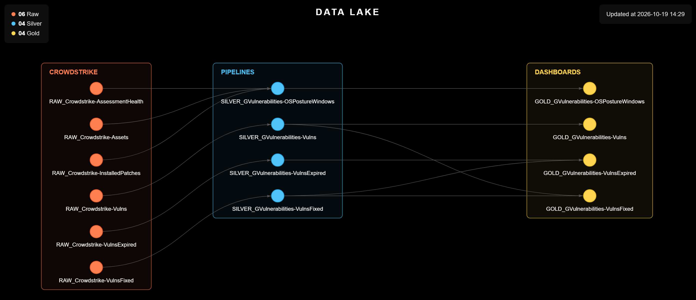

# Vulnerability Management (Client C)

> Turns the vulnerabilities and operating system posture that CrowdStrike Falcon detects on Client C's hosts into monthly files ready for the Data Lake and the GOLD indicators.

<p align="center">
  
</p>

<table width="100%">
<thead>
<tr><th>Before<div></div></th><th>Now<div></div></th><th>What it buys<div></div></th></tr>
</thead>
<tbody>
<tr><td>About 1 day of work to build the report. A flow exported from Spotlight, in a single 10-column monthly CSV, the vulnerabilities of Workstations and Servers in every status, with no time window, and sent the file to SharePoint.</td><td>Separate monthly files for the vulnerabilities active, fixed and expired in the previous month, plus one with the OS posture of the Windows hosts, in the Data Lake standard and including the Domain Controllers.</td><td>A month-by-month history with no gaps or duplicates that does not depend on Spotlight's retention; drops in active vulnerabilities explained by a fix or by a host that left; pending patches and OS checks next to the CVEs.</td></tr>
</tbody>
</table>

---

## Why This Project Exists

**Situation:** Building the vulnerability report for Client C's hosts took about 1 day of work. The data was extracted from CrowdStrike Spotlight into a single monthly file that mixed open, fixed and expired vulnerabilities, left the Domain Controllers out and was only kept in SharePoint. Since Spotlight keeps fixed vulnerabilities for about 90 days, there was no way to follow how fixes evolved or to explain a drop in the number of open ones.

**Task:** Build a monthly collection, following the CYBER__ project standard, that separates what is open from what was fixed or expired, brings the operating system posture of the hosts and feeds the Catalog documentation and the GOLD indicators.

**Action:** Two scripts read the CrowdStrike Falcon APIs (Spotlight, Hosts and Zero Trust Assessment) with the credential obtained from the vault. The first takes a snapshot of the active vulnerabilities and collects those fixed and expired in the previous calendar month; the second gathers, for each Windows host, the Zero Trust OS score, the OS checks and the summary of installed and pending patches.

**Result:** Collection becomes automatic: every month, `Datas/MM-YYYY/` receives up to four CSVs that stack into history: what is open, what was fixed, what disappeared together with its host, and how the operating system of each machine stands.

---

<details>
<summary><strong>Scripts</strong> (click to expand)</summary>

<table width="100%">
<thead>
<tr><th>Script<div></div></th><th>What it does<div></div></th></tr>
</thead>
<tbody>
<tr><td><code>Scripts/1. EDR/1.1. Generate_Vulnerabilities.py</code></td><td>Queries Spotlight in three slices and writes one CSV for each: <code>RVulnerabilities-Active.csv</code> (vulnerabilities open and reopened at the time of the run), <code>RVulnerabilities-Fixed.csv</code> (fixed in the previous calendar month) and <code>RVulnerabilities-Expired.csv</code> (expired in the previous month because the host stopped reporting or was reinstalled; only generated when something expired). Each row is a host × vulnerability pair, with the host type, platform and system, CVE, CVSS severity, ExPRT, exploit maturity, CISA KEV flag and due date, adversaries and affected software. The active file also carries the age in days, the suppression state, the recommended fix and <code>Item: CISA Due Date</code>; the fixed file, the fix date; the expired file, the expiration date and the last time the host was seen.</td></tr>
<tr><td><code>Scripts/1. EDR/1.2. Generate_OSPosture.py</code></td><td>Reads the Windows hosts from Hosts, the Zero Trust assessment and the installed patches from Spotlight, and writes <code>RVulnerabilities-OSPosture.csv</code>, one row per host: OS score, active and pending patches, last confirmed patch, date of the last assessment, <code>Item: Reboot Pending</code> and one <code>Item:</code> (Ok / Attention) per Zero Trust OS check.</td></tr>
</tbody>
</table>

</details>

<details>
<summary><strong>Setup and Usage</strong> (click to expand)</summary>

**Windows**

```
python -m venv .venv
.venv\Scripts\Activate.ps1
```

**Linux**

```
python3 -m venv .venv
source .venv/bin/activate
```

(Skip this step if `.venv` already exists.)

```
cd Scripts
pip install -r requirements.txt
```

The two scripts are independent and can run in any order; run them once a month: each run collects the vulnerabilities active at that moment and those fixed and expired over the whole previous month.

```
python './1. EDR/1.1. Generate_Vulnerabilities.py'
python './1. EDR/1.2. Generate_OSPosture.py'
```

```
deactivate
```

</details>

---

## License

Released under the MIT License, like the rest of this repository. Full terms in [LICENCE.md](../../LICENCE.md).
