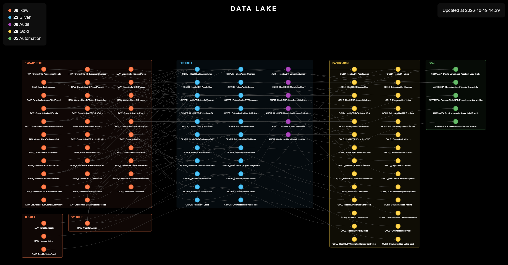

# Data Lake Documentation Catalog

> An automated, visual Data Lake, auto-filled by an AI skill + live projects documented from scratch.

<p align="center">
  <a href="https://jkienen.github.io/Catalog-DataLake_v1/Catalog/DataLake-Graph_Pyvis.html">
    
  </a>
  <br>
  <a href="https://jkienen.github.io/Catalog-DataLake_v1/Catalog/DataLake-Graph_Pyvis.html"><strong>Open the live graph -></strong></a>
</p>

- **What this is:** one YAML file per source, rule, audit, indicator or automation, organized around the **medallion architecture** (Raw → Silver → Gold) plus an **Audit** layer and an **Automation** layer.
- **Who fills it in:** a Claude Code skill reads a project dropped into the catalog and writes the files straight from the code — nobody transcribes by hand.
- **What you get:** an interactive graph, filtered by client, platform and project, where every source, rule and action is one clickable node instead of one row in a shared sheet.

---

## Why This Matters

Automations save time. But each one is a decision made on someone's behalf, silently, on a schedule, using logic only its author can see. Multiply that across teams and platforms, and convenience turns into risk:

- **No one owns the full picture.** Automations get built script by script, each with its own credentials, schedule, and hard-coded rule. Ask "what automatically deletes, tags, or closes something in production right now?" and the honest answer is usually "let me check with a few people."
- **Evidence disappears with the action.** An automation that deletes or closes a record also removes the only proof it existed. When an audit, an incident, or a customer complaint asks why the record is gone, there is nothing to point to.
- **Duplicated effort.** Without a shared catalog, two teams solve the same problem twice, slightly differently, against the same source system — doubling the maintenance burden and the number of places a bug can hide.
- **Institutional risk.** The rule deciding what gets changed or deleted lives in one person's script, in one person's head. When that person is unavailable, nobody can safely extend, or even fully trust, what the automation does.

Every automation here traces back to a **project** — a folder under [`Projects/`](Projects/) holding the code it was built for. `CYBER__HealthEDR` exists to keep EDR sensor health above a threshold. `CYBER__HealthIDP` does the same for Identity Protection: domain controllers, accounts, connectors and access rules. `CYBER__DeviceControl` exists to keep USB exceptions from going stale. `CYBER__GVulnerabilities` exists to track vulnerabilities against the asset inventory, and `CYBER__RVulnerabilities` to follow, month by month, the vulnerabilities and OS posture one client's EDR detects. `CYBER__FalconAudits` exists to make access and sensitive actions inside each tenant visible, and `CYBER__FlightTenants` to keep the whole tenant hierarchy — hosts, users and modules — in one view. Documenting an automation without naming the problem it solves is documenting an action with no reason attached — the catalog ties the two together by construction, not by convention.

That is the case worth making to a manager: not "we documented our data," but **"we can show, at any moment, everything that acts on our systems automatically, why it does it, and what it did, before an incident forces us to find out the hard way."**

---

## From Spreadsheet to Catalog

This is the second iteration of the project — the first lived in a single Excel workbook, [`Catalog-DataLake_v0`](https://github.com/jkienen/Catalog-DataLake_v0). It did the job until the Data Lake outgrew it: a day of analyst work to document one automation, thousands of rows to scroll through to find one entry, and no structure stopping two rows from describing the same rule differently. Every idea it got right — one entry per source, rule or automation; the medallion architecture; an Audit layer that survives the action erasing its evidence — carries over here. What changed is how entries get produced and how they get read:

<table width="100%">
<thead>
<tr><th><div></div></th><th>v0 — the spreadsheet<div></div></th><th>v1 — this catalog<div></div></th></tr>
</thead>
<tbody>
<tr><td>Unit of documentation</td><td>one row in a shared workbook</td><td>one YAML file per entry</td></tr>
<tr><td>Who fills it in</td><td>an analyst, by hand</td><td>a Claude Code skill, read from the code</td></tr>
<tr><td>Layers</td><td>4, with Audit only a field</td><td>5, with Audit promoted to its own layer</td></tr>
<tr><td>Silver and Gold</td><td>merged into one row</td><td>separate files</td></tr>
<tr><td>Finding an entry</td><td>scroll and filter thousands of rows</td><td>an interactive graph, filtered by client, platform and project</td></tr>
<tr><td>What keeps it consistent</td><td>discipline</td><td>a fixed template per layer</td></tr>
</tbody>
</table>

---

## How It Works

The documentation mirrors the lifecycle of the data across five layers:

<table width="100%">
<thead>
<tr><th>Layer<div></div></th><th>What it holds<div></div></th><th>Documented in<div></div></th></tr>
</thead>
<tbody>
<tr><td><strong>Raw</strong></td><td>Data ingested exactly as the source delivers it, with no transformation.</td><td><code>1-Raw/RAW_*.yaml</code></td></tr>
<tr><td><strong>Silver</strong></td><td>Cleaned, cross-referenced, and structured data, ready for analysis.</td><td><code>2-Silver/SILVER_*.yaml</code></td></tr>
<tr><td><strong>Audit</strong></td><td>Records the rule sets apart, kept inside the Silver layer's history so the evidence survives an automation acting on them.</td><td><code>3-Audits/AUDIT_*.yaml</code></td></tr>
<tr><td><strong>Gold</strong></td><td>Business indicators / KPIs derived from the Silver layer and from the records set apart in each Audit.</td><td><code>4-Gold/GOLD_*.yaml</code></td></tr>
<tr><td><strong>Automation</strong></td><td>Automated actions that read the curated data and act back on the platform it came from.</td><td><code>5-Automations/AUTOMATA_*.yaml</code></td></tr>
</tbody>
</table>

Each layer feeds the next: Raw is the input to the Silver rules, the records those rules set apart become Audits, the Silver output is consolidated into Gold indicators, each Audit gets Gold indicators of its own, and Automations consume the curated data — and the audits — to act.

---

<details>
<summary><strong>Repository Structure</strong> (click to expand)</summary>

```
Catalog-DataLake/
├── Projects/                       # The source projects being documented, one problem per project
│   ├── CYBER__DeviceControl/
│   ├── CYBER__FalconAudits/
│   ├── CYBER__FlightTenants/
│   ├── CYBER__GVulnerabilities/
│   ├── CYBER__HealthEDR/
│   ├── CYBER__HealthIDP/
│   └── CYBER__RVulnerabilities/
├── Catalog/
│   ├── Layers/                     # The live catalog: one YAML per dataset, rule, audit, indicator or automation
│   │   └── <Client>/               # One folder per client: CLIENT-A is the parent; CLIENT-B and CLIENT-C reuse its documentation, adapted to their own tenants (CLIENT-C also has a project of its own); the parent is set in PARENT_CLIENT, in the graph generator
│   │       ├── HML/{1-Raw,2-Silver,3-Audits,4-Gold,5-Automations}/
│   │       └── PRD/{1-Raw,2-Silver,3-Audits,4-Gold,5-Automations}/
│   ├── Skills/
│   │   ├── Catalog.md              # The Claude Code skill that documents a dropped project
│   │   ├── Code.md                 # The Claude Code skill that generates or reviews the code of a CYBER__ project
│   │   ├── Templates/              # The five YAML templates, one per layer
│   │   └── Temp/                   # Where a dropped project is documented and reviewed before moving to Layers/, and where CYBER__ code is generated or reviewed (kept out of git)
│   ├── Scripts/
│   │   ├── Generate-Graph_Pyvis.py # Reads Layers/ and renders the HTML graph
│   │   ├── README.md               # Setup of the generator and its constants
│   │   └── requirements.txt        # The generator's dependencies
│   ├── Files/                      # Images referenced by the documentation, plus the demo GIF and video
│   └── DataLake-Graph_Pyvis.html   # The generated visualization
├── CLAUDE.md
├── LICENCE.md
├── README.md
└── Review.md                       # The Claude Code skill that reads the catalog and the projects and makes pointed fixes
```

</details>

<details>
<summary><strong>Generating or Reviewing a Project's Code</strong> (click to expand)</summary>

Besides documenting, the repository carries a second skill, [`Catalog/Skills/Code.md`](Catalog/Skills/Code.md), that takes care of the code of the `CYBER__` projects themselves and brings it to the team's standard: source folders numbered in run order, scripts split into Parts, authentication through the vault, outputs under `Datas/`, `Ok` / `Attention` checks, README, CLAUDE.md, LICENCE.md (for a project kept in its own repository), a `.gitignore` (which keeps the `.env` and the data under `Datas/` out of git) and requirements.

1. To start from a project that already exists, drop it into `Catalog/Skills/Temp/`, under any name: it does not need to start with `CYBER__`. With no project in `Temp/`, the skill starts from what you want to report on. The new project is written to `Catalog/Skills/Temp/CYBER__<Project>/`, never into the catalog repository itself.
2. Ask it to **generate** or to **review**. In both cases, the default is to write a new project from zero, already in the standard:
   - when there is a project in `Temp/`, it serves as the example and is only read;
   - a coverage table makes sure no information of the example is left out without your decision;
   - every output is validated by you before the script is called finished.
3. Only when you explicitly ask to keep the existing project is it **reorganized in place**. The organization of the code changes, but not what it produces: the same files, the same columns and the same values.

Unlike the documentation skill, this one runs scripts, because running is how the output of a new project is validated and how a reorganization is proven to have changed nothing. It only runs a script with your authorization, only scripts that just read from the platforms, and validates the result through an in-memory summary, without opening the data files. Calls that write to the platforms are never run by it, and the ones that arrive commented out stay commented out.

</details>

<details>
<summary><strong>Documenting a New Project</strong> (click to expand)</summary>

Where the spreadsheet asked an analyst to read the code and transcribe it by hand, this catalog asks a Claude Code skill to do the reading:

1. Drop the project's repository into `Catalog/Skills/Temp/<RepositoryName>/`.
2. Ask the skill to document it. It sweeps every API call, business rule, set-aside record, indicator and platform action in the code, and turns each one into a YAML file (`RAW_*`, `SILVER_*`, `AUDIT_*`, `GOLD_*`, `AUTOMATA_*`) following the field-by-field template of its layer.
3. Run the scripts once, when it asks. Before that, the skill adds a temporary capture to the code that records a sample of each dataset and the size of each extraction; after reading the result, it puts the scripts back the way they were.
4. Confirm what it proposes along the way: the file names, the rules it read from the code, the Gold layer indicators (you choose among up to ten candidates per file) and, at the end, the load type of each Raw, `Full` or `Incremental`.
5. Review the files it wrote in `Catalog/Skills/Temp/`. Nothing reaches the live catalog until you approve them.
6. Once approved, the files move into `Catalog/Layers/<Client>/HML/`, one numbered folder per layer; they move to `PRD/` when the rules go into production. If the same project runs for other clients, the skill can replicate the documentation for each one, adjusting the sources and the columns that change.

The skill never runs the project's scripts itself, since they authenticate against production platforms and, in the Automation layer, act on them: the one who runs them is you.

**Benefits:**

- **Fewer nodes**: one node per rule instead of one per manually transcribed entry, cutting redundancy out of the graph.
- **Derived from the code**: every document reflects the rules actually applied in the scripts, not what an analyst remembered while transcribing them.
- **Consistent structure**: every file the skill writes follows the same field-by-field template, no matter who ran it or which project it came from.

</details>

<details>
<summary><strong>Loading the Context and Making Pointed Fixes</strong> (click to expand)</summary>

A third skill, [`Review.md`](Review.md), at the root of the repository, neither documents nor generates anything. It reads what the other two produced and fixes what you point out.

1. Ask it to load the context. The skill reads `Catalog.md`, `Code.md` and the templates. Then it reads the whole of `Catalog/Layers/`: the main client in full and the replicas compared against it. Finally, it reads the reference projects in `Projects/`. Nothing is changed in this phase.
2. It returns a report with:
   - anything urgent first, such as a `.env` tracked in git;
   - the map of projects per client;
   - how far each project is from the standard;
   - a numbered list of pending items, with the inconsistencies inside the catalog and between the code and what the catalog documents.
3. Ask for the fixes one by one, by the number of the pending item or by describing the point. Each fix is the smallest change that resolves the request. Whatever the skill finds along the way becomes a new pending item, never a fix made in passing.

Before changing anything, the skill looks for everything that depends on the change, so that nothing is left pointing at the old value:

- the README and the other scripts of the project;
- the YAMLs and their replicas in the other clients;
- the skills themselves.

Renaming a source's folder, for example, also updates the scripts table and the run commands in the README. When the change goes beyond one file, the skill shows the plan first and waits for your confirmation. After applying it, it runs the search again to show that nothing was left behind.

It never opens `.env` files or data files, never runs the projects' scripts and never runs git commands that write: committing is yours. The only script it may run is the graph generator, after a change in `Layers/` and only with your authorization.

</details>

<details>
<summary><strong>Visualizing the Catalog</strong> (click to expand)</summary>

Every YAML file under `Catalog/Layers/` is a node; every `sources_raw`, `sources_silver`, `sources_audit` and `generates_audits` reference is an edge between them. Each client is viewed on its own, through the client selector: the same `id` can exist in more than one client, and a reference only links files of the same client. Running `Catalog/Scripts/Generate-Graph_Pyvis.py` reads the whole `Layers/` tree and renders `Catalog/DataLake-Graph_Pyvis.html` — the file served by GitHub Pages at [jkienen.github.io/Catalog-DataLake_v1](https://jkienen.github.io/Catalog-DataLake_v1/Catalog/DataLake-Graph_Pyvis.html): an interactive graph, one column per layer and colored by layer, where opening a node shows its description, sample, owner and schedule. The click also lights up the node and the chain linked to it, with a red border and glow, including the nodes not yet in production. Re-run it after every batch of files moves into `Layers/`, so the graph never drifts from the catalog it was built from.

See [Catalog/Scripts/README.md](Catalog/Scripts/README.md) for setup, the configuration constants, and a note on the CDN dependency the generated page carries.

</details>

---

## License

Released under the MIT License: use, adapt and redistribute it freely. Full terms in [LICENCE.md](LICENCE.md).

Every sample in the catalog is fictional or anonymized: the names, addresses, identifiers and organizations in it do not refer to real entities.
